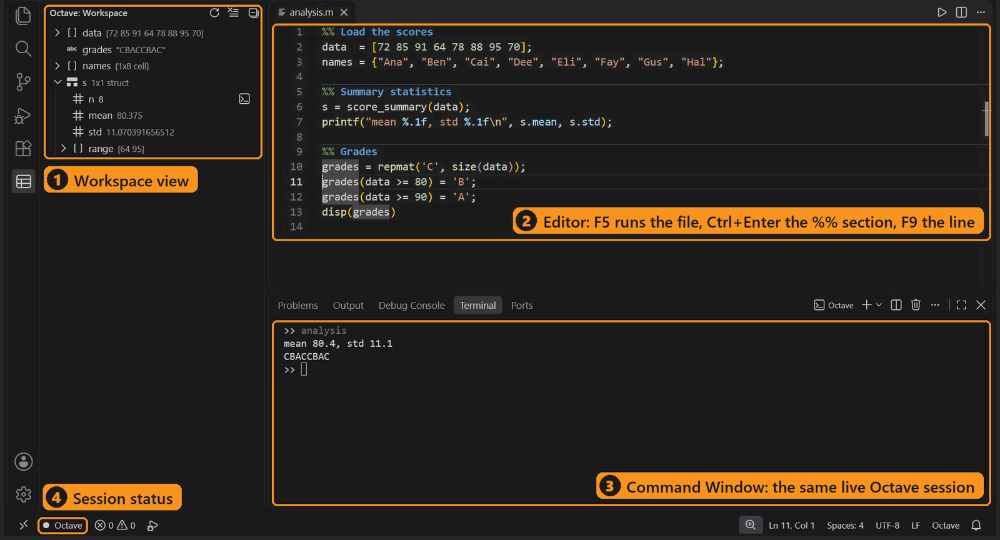
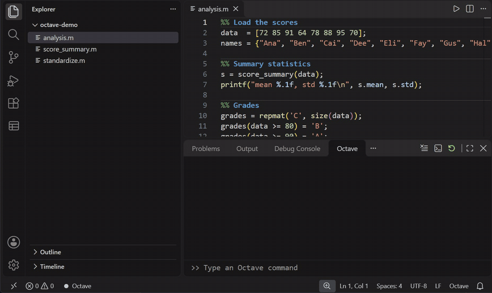
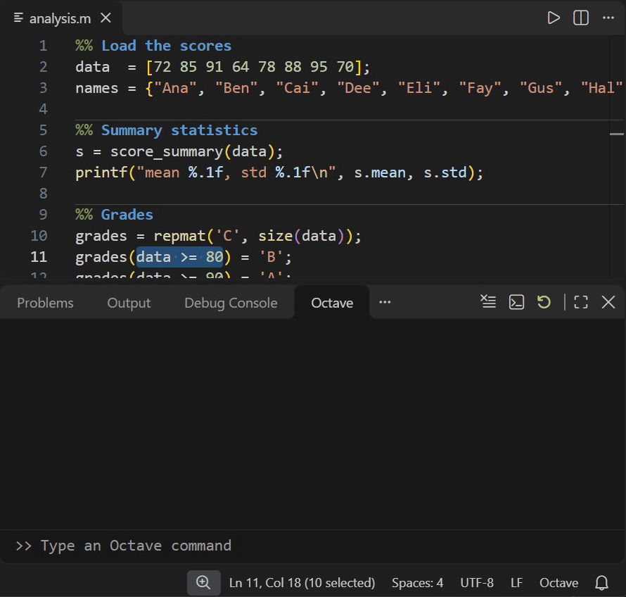
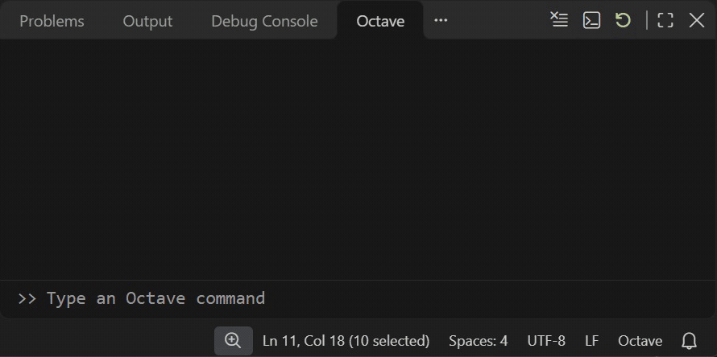
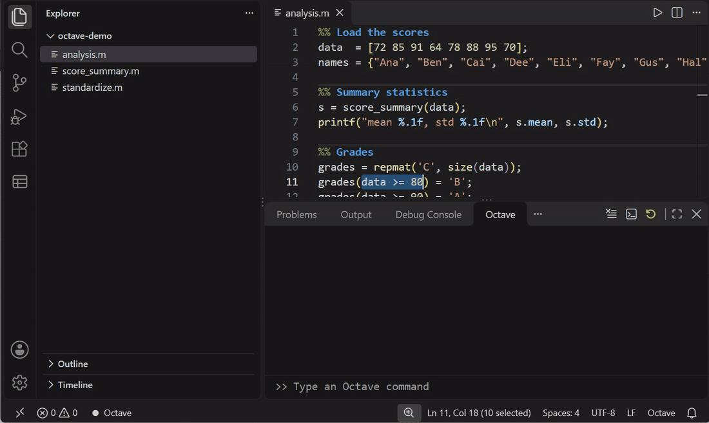
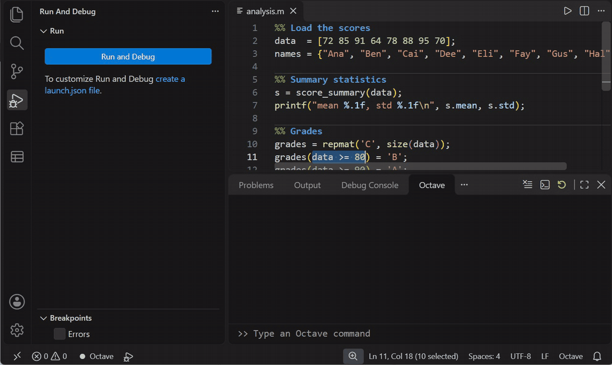

# GNU Octave Session for VS Code

A MATLAB-style workflow for [GNU Octave](https://octave.org) in VS Code: one persistent Octave session shared by
Run, the Command Window, the debugger and the Workspace view, so your workspace survives between runs.



**Highlights:** [Run code](#run-code) · [Command Window](#command-window) · [input() and Stop](#input-pause-and-stop) ·
[Debugging](#debugging) · [Workspace view](#workspace-view) · [AI agents](#mcp-server-for-ai-agents)

## Features

### Run code

Run the current file (**F5** or ▶), the current `%%` section (**Ctrl+Enter**), or the selection or current line
(**F9**). Everything runs in the same session, in the base workspace, and shows up in the Command Window.



### Command Window

The *Octave* tab in the bottom panel, next to Terminal, works like MATLAB's Command Window. It is a view of the
same session that Run, the debugger and the MCP server use: one Octave process, one workspace.



- **Output:** select and copy with the mouse, errors in red, warnings in yellow. File paths and the "called from"
  lines of an error are links that open the file at that line. Long outputs collapse once the command finishes
  (*Show all N lines* expands them). `clc` clears it, and so does the *Clear* button in the title bar.
- **Input line** with Octave syntax highlighting: **Enter** runs, **Shift+Enter** adds a line (the block runs as
  one), **↑/↓** recall earlier commands that start with what you typed, **Esc** clears the line.
- **Completion** pop-up from the live session (variables, struct fields, functions on the path; **Ctrl+Space** or
  **Tab**), a **help tooltip** when you hover a name (usage, description and the defining file), and the usage of
  the function you are typing a call to under the input line. These only ask Octave when it is idle.
- `edit name` and `open name` open scripts and functions (also Octave's own) in the VS Code editor; `edit newname`
  creates `newname.m` in the current folder, and `edit` alone opens a new untitled file.
- The classic terminal view is still there: *Octave: Show Command Window as Terminal* (or the terminal icon in the
  Command Window's title bar), with history (↑/↓ with prefix search), Ctrl+C and Tab completion. Both views show
  the same session; `octave.commandWindow.view` chooses which one opens by default.

### input(), pause and Stop

When running code calls `input`, `yes_or_no` or `pause`, the input line switches to answering it, so the window
never looks stuck. While a command runs, **Stop** (or Ctrl+C, or the title-bar button) interrupts it, and Enter
queues the next command.



### Debugging

Set breakpoints in the gutter. Any run that reaches one stops there, whether from F5, F9 or a call typed in the
Command Window, and the debug view opens with the call stack, variables, watch and hover. Step with F10/F11 or
continue with F5; at the `K>>` prompt the Command Window runs commands in the paused function's workspace.
*Errors* in the Breakpoints view works like `dbstop if error`.



### Workspace view

The *Octave* icon in the activity bar shows the variables of the session (of the current frame while debugging)
with their values; hover for size and class. Expand structs, cells and matrices. Right-click to show a variable in
the Command Window, copy its value or delete it; the title bar refreshes or clears the workspace. It updates after
every command.



### Also included

- **Completion and signature help in the editor** from the live session: functions on the path, workspace
  variables, struct fields, and argument hints from Octave's help text and your own function declarations.
- **Language support:** syntax highlighting, outline and breadcrumbs (functions, `%%` sections, classdef members),
  folding, auto-indent, and separator lines above `%%` sections.
- **MCP server for AI agents** (optional): Claude Code, Copilot, Cursor and other agents can use the same live
  session. See below.

## Requirements

- Windows 10 or 11 with **GNU Octave 6 or newer** (tested with 11.1). Linux and macOS may work with `octave` on
  `PATH`, but are untested.
- Octave is found automatically in these places, in order:
  1. `C:\Program Files\GNU Octave\Octave-x.y.z` (the newest version), or `%LOCALAPPDATA%\Programs\GNU Octave`;
  2. a custom install folder recorded by the Octave installer;
  3. Scoop;
  4. `PATH`.

  Otherwise set `octave.executable`.

## Install

In VS Code, open the Extensions view, choose **⋯ → Install from VSIX…** and pick `octave-session-<version>.vsix`,
or run `code --install-extension octave-session-<version>.vsix`. Then open a `.m` file.

## Settings

| Setting | Default | |
|---|---|---|
| `octave.executable` | auto-detect | `octave-gui.exe`/`octave-cli.exe`, an Octave install folder, or a command on `PATH`. Per machine (not synced). |
| `octave.startupCommands` | `[]` | Commands run when a session starts, e.g. `["pkg load signal"]`. |
| `octave.commandWindow.view` | `webview` | Which Command Window opens: `webview` (the panel view with links, completion and help) or `terminal` (the raw Octave terminal; closing it ends the session). |
| `octave.sectionSeparators` | `true` | Lines above `%%` sections. |
| `octave.mcp.enabled` | `false` | Run the MCP server for AI agents (see below). Per machine. |
| `octave.mcp.port` | `39217` | Preferred MCP port; the next 10 ports are tried if it is taken. Per machine. |

## MCP server for AI agents

An optional [MCP](https://modelcontextprotocol.io) server lets AI agents (Claude Code, Copilot, Cursor, ...) use the
**same live Octave session** you see: code an agent runs shows up in your Command Window, and variables are shared
both ways. It is off by default.

Run **Octave: Set Up MCP Server** from the Command Palette. It enables the server and offers to copy either the
`claude mcp add ...` command for Claude Code or a JSON `mcpServers` entry for other clients. The connection is
`http://127.0.0.1:<port>/mcp` with an `Authorization: Bearer <token>` header. The token is stable across restarts;
**Octave: Reset MCP Token** replaces it. Octave itself starts when an agent first needs it.

| Tool | What it does |
|---|---|
| `octave_run` | Run code in the base workspace (echoed in the Command Window); returns the output. |
| `octave_run_file` | Run a `.m` script by path, with your breakpoints active. |
| `octave_status` | Session state, Octave version, current folder, call stack when debugging. |
| `octave_workspace` | List variables with class, size and a value preview. |
| `octave_get_value` | Display text of a side-effect-free expression (hidden, not echoed). |
| `octave_help` | Usage signatures and help text of a function. |
| `octave_interrupt` | Abort the running command. |
| `octave_debug` | Continue, step, step in/out or quit while stopped at a breakpoint. |
| `octave_breakpoints` | List, add or remove editor breakpoints. |

**Security:** the server listens on `127.0.0.1` only, requires the bearer token, rejects foreign `Origin` and `Host`
headers, and never starts in an untrusted workspace. Still, an agent that has the token can run **any** Octave code,
including `system()`, with your user rights. Enable it only when you want that, treat the token like a password
(the copied command and JSON contain it), and reset it if it leaks.

### Agent skills

`agent-toolkit/` holds skills that teach agents how to use these tools well (run code, debugging, testing,
code review), as a Claude Code plugin or plain `SKILL.md` folders for other agents. See
`agent-toolkit/README.md` in the repository.

## Tips and troubleshooting

- **The MATLAB extension is also installed?** Both claim `.m` files. The first time a `.m` file opens as MATLAB,
  this extension offers to switch. Or add `"files.associations": { "*.m": "octave" }` to your settings.
- **Restricted Mode:** in an untrusted folder, highlighting, outline and folding still work. Running code needs a
  trusted workspace.
- **Something doesn't work?** Open *Output → Octave Session* for the log. *Octave: Restart Session* starts a
  fresh Octave.
- **Ctrl+C** interrupts Octave through a small Windows PowerShell helper. If PowerShell is blocked by policy,
  use *Restart Session* instead.
- **Pause** in the debugger isn't possible on Windows. Use breakpoints, or Stop.
- **`input`, `yes_or_no`, `pause` and `clc`** are wrapped by small helper functions while the extension's session
  runs (like `edit` and `open`), so the Command Window knows when Octave waits for an answer. `pause` with no
  argument waits for Enter in the Command Window (Octave's own `pause` waits for a key in a hidden console window).
  `which input` shows the wrapper; it calls Octave's built-in function.
- Scripts are run by name from their own folder, like MATLAB. A file name that isn't a valid Octave name
  (spaces, dashes) still runs, but without breakpoints.

## Development

```
npm install
npm run compile          # type-check and bundle (dist/extension.js, dist/commandWindow.js)
npm run package          # build octave-session-<version>.vsix
npm run test:unit        # parser, grammar, completion helpers, command queue, control records
npm run smoke            # session core against a real Octave
npm run smoke:debug      # debugger core against a real Octave
npm run test:prompts     # prompt detection (input, pause, keyboard, debugger) and the queue against Octave
npm run test:integration # end-to-end in a separate VS Code instance
```

## Credits

The icon is based on the GNU Octave logo, with record grooves added for the "session". This extension is not part
of or endorsed by the GNU Octave project or MathWorks.
